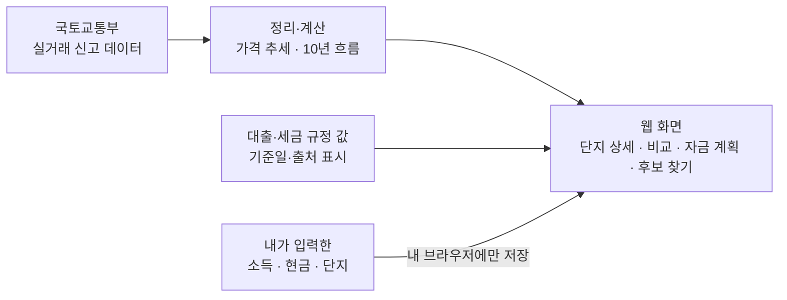
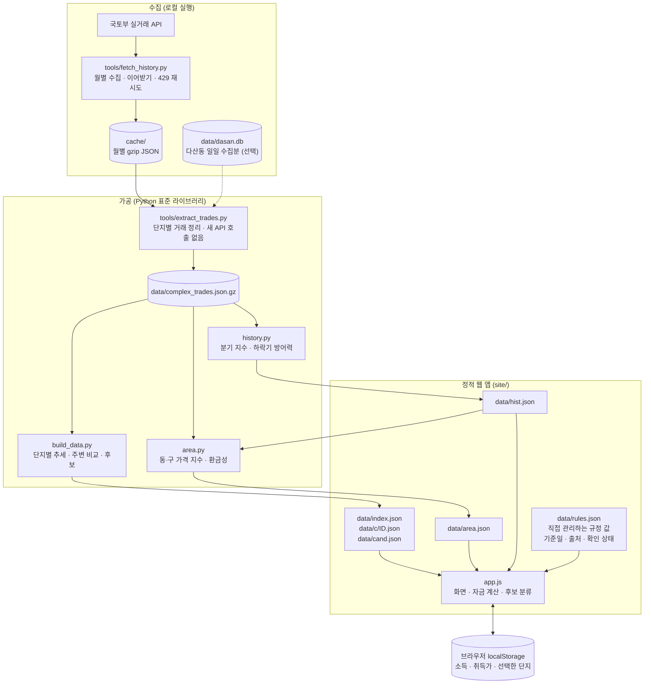

# 갈아탈까

> 지금 사는 집을 팔고 다른 집으로 옮기려는 사람이, **두 집의 가격 흐름과 필요한 돈을 한 화면에서 비교**할 수 있게 만든 웹 서비스 프로토타입입니다.

## 이런 고민에서 시작했습니다

집을 옮기려는 사람은 보통 이런 질문을 합니다.

- 내 집과 가고 싶은 집, **요즘 가격이 오르고 있나, 내리고 있나?**
- 집값이 한창 떨어졌던 때(2022~23년)에 **어느 쪽이 덜 빠졌나?**
- 내 집을 팔고 저 집을 사려면 **내 돈이 실제로 얼마나 더 필요한가?** (세금·중개수수료·이사비까지)
- 내 연봉과 현금으로는 **어느 동네, 어느 집까지 가능한가?**

이 정보는 여러 사이트와 계산기에 흩어져 있고, 대출 규제는 자주 바뀝니다. 그리고 가격 그래프 하나만 보고는 "그래서 갈아탈 수 있나?"에 답하기 어렵습니다. 갈아탈까는 이 질문들을 **한 흐름**으로 이어서 보여주려고 만들었습니다.

## 무엇을 보여주나

서비스가 돌아가는 큰 흐름은 아래와 같습니다.



| 화면 | 알려주는 것 |
|---|---|
| **홈** | 맨 위에 'A → B 갈아타기 한눈에'(부족하거나 남는 돈 요약), 내 집(A)·후보(B) 카드와 6개월 추세, 주변과의 비교 |
| **단지 상세** | 이 아파트의 추정 시세(평형·층별), 최근 6개월 동안 오름·비슷함·내림, 최근 거래 목록 |
| **A↔B 비교** | 내 집(A)과 후보 집(B)의 가격 흐름을 나란히, 10년치 그래프로 비교 |
| **자금 계획** | A를 팔고 B를 살 때 필요한 돈. 취득세·중개수수료·법무비·이사비 포함, "집값이 이만큼 변하면?" 시나리오까지 |
| **조건으로 후보 찾기** | 연소득과 보유 현금을 넣으면 "살 수 있음 / 빠듯함 / 어려움"으로 나눈 단지 목록 |
| **관심 입지** | 동·구를 최대 5곳 골라(이름으로 검색) 10년 가격 추이와 거래가 얼마나 활발한지(환금성)를 나란히 비교 |

용어를 쉽게 풀면 이렇습니다.

- **추정 시세**: 호가(부르는 값)가 아니라 **실제로 거래되어 신고된 가격**(국토교통부 실거래가)으로 계산한 값입니다.
- **상승 / 주춤 / 하락**: 최근 6개월 가격 변화를 보고, 약 ±3% 안이면 "주춤"이라고 표시합니다.
- **하락기 방어력**: 2020~22년 고점에서 2024년 2분기 저점까지 얼마나 빠졌고, 고점을 되찾는 데 몇 분기 걸렸는지입니다. 과거 기록일 뿐 앞으로를 말해주지는 않습니다.
- **살 수 있음 / 빠듯함 / 어려움**: 단지의 예상 가격대(낮은 쪽~높은 쪽)를 내 자금으로 감당할 수 있는지로 나눕니다. 높은 쪽까지 되면 "살 수 있음", 중간값까지만 되면 "빠듯함", 중간값도 안 되면 "어려움"입니다.
- **환금성**: 최근 12개월 거래가 몇 건이었는지, 전년이나 10년 평균과 비교해 어떤지, 하락기에 거래가 얼마나 줄었는지입니다. 거래가 이어졌던 곳일수록 팔고 싶을 때 거래가 있었던 곳입니다. 세대수는 반영하지 않습니다.
- **대출 규제**: 집값 구간별 대출 한도, 소득 대비 원리금 상환 비율(DSR), 허가 없이는 살 수 없는 구역(토지거래허가구역) 등을 반영합니다.

처음 열면 예시 단지로 채워진 화면이 보여서 입력 없이도 전체 흐름을 둘러볼 수 있고, 처음 방문 때 한 번 **5단계 사용 가이드**가 열립니다(설정에서 다시 볼 수 있어요). 화면 위의 **㎡ | 평** 버튼으로 면적 단위를 바꿀 수 있습니다(평은 전용면적을 환산한 값이라 분양·공급면적 기준 평형과 다릅니다).

## 숫자를 믿을 수 있게 하려고 한 일

이 서비스에서 가장 신경 쓴 부분은 **"모르는 것을 아는 척하지 않는 것"** 입니다.

- **거래가 적은 단지는 결론을 내지 않습니다.** 최근 거래가 몇 건 없으면 "오름/내림" 대신 **"참고용"** 으로 평균만 보여주고, 그것도 어려우면 **"표본 부족"** 이라고 적습니다.
- **불확실한 정도를 함께 보여줍니다.** 예를 들어 "상승(추정) +6%, 범위 +0.5%~+12%"처럼 범위를 같이 표시하고, 범위 전체가 기준을 넘을 때만 "확실"이라고 합니다. (숫자는 예시입니다.)
- **최근 데이터는 불완전합니다.** 거래 신고는 늦게 들어오기 때문에, 기준일을 두 달 전 월말로 잡았습니다.
- **규정은 바뀝니다.** 대출·세금 규정 값은 기준일과 출처를 붙여 따로 관리하고, 90일이 지나면 "규정이 바뀌었을 수 있어요"라고 경고합니다. 공식 자료로 확인하지 못한 값은 "확인 필요"로 표시합니다.
- **만든 사람이 만든 테스트만 믿지 않았습니다.** 만든 사람과 다른 검토자(AI 에이전트)가 항목을 나눠 따로 검증했습니다.
  - 최근 거래가 없는 단지에서 **터무니없이 큰 변화율이 나오는 오류**를 찾아 고쳤습니다.
  - 규정 설명 **3건이 공식 자료와 달라 정정**했습니다.
  - "예산이 늘면 살 수 있는 단지가 줄지 않는다" 같은 **상식 규칙을 무작위 입력 1만 번**으로 확인했고, 어긋난 경우는 0건이었습니다.
  - 국토교통부에서 **50건을 다시 조회**해 내 데이터와 모두 일치함을 확인했습니다.
  - 동·구 단위 가격 지수는 **다른 방법과 분기 변화 상관 0.85 이상**, 입지별 거래 건수는 **원본을 직접 센 값과 일치**함을 테스트로 고정했습니다.
- **쓰기 쉬운지도 반복해서 점검했습니다.** 화면을 직접 보며 세 번에 걸쳐 문제를 찾아 고쳤습니다(입력 중에도 결과 고정, 어려운 용어 풀이, 키보드·접근성 등). 기록은 `docs/ux-improvements.md`에 있습니다.

## 이 서비스의 한계

- **투자 권유가 아닙니다.** 오를 집이나 사야 할 집을 골라주지 않고, 세금·대출을 확정해 주지도 않습니다. 모든 수치는 추정입니다.
- **볼 수 있는 지역이 정해져 있습니다.** 서울 25개 구, 구리, 하남, 남양주 다산동, 수원(장안·권선·팔달·영통), 성남 분당, 안양 동안, 의왕, 화성 동탄구입니다.
- **입지(동·구) 비교에는 한계가 있습니다.** 동에 가격 흐름을 만들 만큼 단지가 모이지 않으면(분기마다 5개 이상 필요) 가격 추이는 생략하고 구·시로 보라고 안내합니다. '단지당 거래'는 세대수를 몰라 큰 단지가 많은 곳에서 높게 나옵니다.
- **과거 기록은 미래를 말해주지 않습니다.** "상승"은 최근 6개월의 변화일 뿐입니다.
- **가정한 값이 있습니다.** 대출 금리 4.0%, 만기 30년, 전세가율 60%는 근거 있는 값이 아니라 가정이며 화면에서 바꿀 수 있습니다.
- **공식 확인이 안 된 부분이 있습니다.** 일부 지역(다산동·수원 권선구·동탄구)의 규제 지정 여부는 공식 고시와 대조하지 못했습니다.
- **개인정보**: 입력한 소득·현금·단지는 서버로 보내지 않고 **내 브라우저에만** 저장합니다. 설정에서 지울 수 있습니다.

---

## 개발자를 위한 정보

<details>
<summary>데이터 구성, 실행 방법, 검증 수치 보기</summary>

### 데이터
국토교통부 아파트 매매 실거래(2016-10 ~ 2026-09) 966,114건, 6,251개 단지. 그중 상승/주춤/하락 라벨은 2,141개, 참고용은 1,015개, 분기 지수는 3,707개, 하락기 방어력은 1,229개 단지에 있습니다. 입지 단위로는 구·시 36개와 동 396개(그중 214개 동에서 가격 지수 산출)를 집계합니다. 취소 표시는 2020-02부터, 직거래 구분은 2021-11부터 원본에 있어 그 이전 구간은 제외하지 못합니다.

### 아키텍처
서버 없이 정적 파일만으로 동작합니다. 수집·가공은 로컬에서 한 번 돌려 JSON을 만들고, 화면은 그 JSON을 읽어 브라우저에서 계산합니다.



- 점선은 선택 입력입니다. `data/dasan.db`가 없으면 그 부분만 건너뜁니다.
- 생성 데이터(`cache/`, `data/`, `site/data/`의 `rules.json` 외 파일)는 저장소에 없어서 아래 실행 순서로 직접 만들어야 합니다. `rules.json`은 사람이 관리하는 파일이라 저장소에 있습니다.
- 앱은 같은 폴더의 `data/*.json`만 읽고 외부로 요청하지 않습니다.

### 추세 엔진
단지별 ln(㎡당가) ~ 시간 + 층대 + 평형 최소제곱, 표준오차 ×1.2로 90% 범위, ±3% 임계. 6개월 추세는 (24개월 창 "최근 6개월 속도" 모델 + 12개월 선형)의 평균이고 범위는 두 모델 중 넓은 쪽입니다. 최근 3개월 거래가 2건 미만이면 참고용으로 처리합니다(마지막 거래 이후를 외삽해 극단값이 나오는 문제를 막기 위해).

### 입지(동·구) 분석
`area.py`가 입지 안 단지들의 분기 가격(`hist.json`)을 '단지 고정효과 + 분기효과' 패널로 합쳐 입지 지수를 만듭니다(같은 단지의 변화만 쓰므로 신축이 섞여도 수준이 흔들리지 않고, 분기마다 단지 5개 이상일 때만 값을 냅니다). 환금성은 입지 안 모든 단지의 신고 거래를 직접 세어 12개월 거래, 전년·10년 평균 대비, 단지당 거래, 하락기 거래량 변화로 보여줍니다. 입지 키는 구·시 `11350`, 동 `11350:월계동`입니다.

### 기술 스택
| 영역 | 기술 |
| --- | --- |
| 언어 | Python 3(표준 라이브러리만), JavaScript(프레임워크 없음) |
| 데이터 | 국토교통부 실거래 API, gzip JSON, SQLite(다산동 일일 수집분, 선택) |
| 프론트엔드 | 정적 HTML·CSS·JS, 계산은 브라우저에서 수행 |
| 배포 | 정적 호스팅(runlot 등), `runlot.json` |
| 검증 | pytest, 헤드리스 Chrome, 독립 재계산(`verify/`), 규칙 파일(`site/data/rules.json`) |

### 실행
공공데이터포털에서 "아파트 매매 실거래가 상세 자료" 활용신청 후 `.env.example`을 `.env`로 복사해 `DATA_GO_KR_SERVICE_KEY`를 채웁니다. 생성 데이터(`cache/`, `data/`, `site/data/`의 나머지)는 저장소에 없어서 아래 순서로 만들어야 화면이 채워집니다.

```
python3 tools/fetch_history.py 201610 202609            # 과거 월별 실거래 → cache/data/
python3 tools/fetch_history.py 201610 202609 cache metro  # 수원 4구·분당·동안·동탄구
python3 tools/fetch_history.py 201610 202609 cache uiwang # 의왕시(내손동 등)
python3 tools/extract_trades.py                         # → data/complex_trades.json.gz
python3 build_data.py [YYYY-MM-DD]                      # → site/data/ (기본 기준일 = 두 달 전 월말)
python3 history.py                                      # → site/data/hist.json
python3 area.py                                         # → site/data/area.json (동·구 가격 지수·환금성, history.py 다음에 실행)
python3 -m http.server 8002 --bind 127.0.0.1 -d site    # http://127.0.0.1:8002/
python3 -m pytest -q                                    # 헤드리스 Chrome 필요
```

URL 오버라이드(테스트용): `#/plan?b=<id>&sale=&buy=&aloan=&bloan=&cash=&move=&tax=`(만원), `?theme=dark&nosplash&nomotion`, `?unit=py`(평으로 표시), `?tour=1`(사용 가이드 열기). `income`·`debt`도 주소로 넣을 수 있지만 그렇게 연 주소에는 소득이 남으니 공유하지 마세요.

### 배포
서버 코드가 없는 정적 사이트라 `site/` 폴더만 올리면 됩니다. `runlot.json`(`assets: "site"`)으로 `runlot deploy` 한 줄이면 되고, 배포 제한(파일 수·압축 크기·이름 규칙)은 테스트가 지킵니다. 월간 데이터를 갱신하면 `site/index.html`의 `?v=` 값을 올려야 브라우저가 새 데이터를 받습니다. 절차는 `docs/deploy-runbook.md`, 배경과 리스크는 `docs/deploy-plan-runlot.md`에 있습니다.

### 검증 결과 요약
- 데이터 확장(5,040 → 6,154 → 6,251개 단지)마다 기존 단지 결과 무변동, 새 지역은 독립 분기 지수와 상관 0.80(서울 0.78).
- 독립 분기 지수는 같은 원천 데이터를 다른 방법으로 계산한 것이라 정답 라벨이 없고, 완만한 구간(2024~2026)의 하락을 잡아내는 비율은 20~38%로 낮습니다.
- 분기 지수 수작업 재계산 평균 오차 0.00%.
- 상세: `docs/verification-report-2026-10-09.md`

### 문서
| 문서 | 내용 |
| --- | --- |
| `docs/service-guide.md` | 서비스 설명, 숫자 읽는 법, 유저별 시나리오 |
| `docs/service-overview.md` | 기획 정리: 원한 것 vs 현재 상태, 기능별 검증, 결정할 것 |
| `docs/ux-improvements.md` | UI/UX 개선 기록(3회 루프, 온보딩) |
| `docs/deploy-plan-runlot.md` | runlot 배포 계획·작업 목록·리스크 |
| `docs/deploy-runbook.md` | 배포·롤백·점검표·월간 데이터 갱신 절차 |
| `docs/candidate-finder-plan.md` | 조건으로 후보 찾기 계획과 결정 기록 |
| `docs/verification-plan.md` | 독립 검증 계획 |
| `docs/verification-report-2026-10-09.md` | 검증 결과, 수정 내역, 지역 확장 기록 |

</details>
